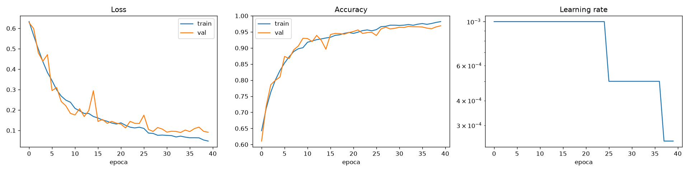
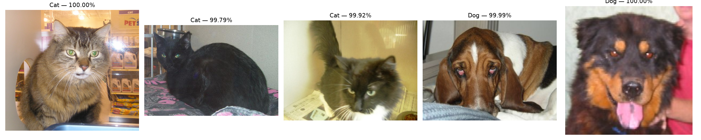

# Cats vs Dogs — CNN da zero (PyTorch)

Classificatore **gatto vs cane** addestrato **da zero** (nessun peso pre-addestrato) su
**24.970 fotografie** del dataset *Dogs vs Cats* di Kaggle, con una CNN scritta in PyTorch
e addestrata sulla GPU Apple (**MPS**).

Il repo contiene tutto quello che serve: download del dataset, training con le best
practice, valutazione e inferenza su nuove immagini.

---

## Risultati

| Metrica | Valore |
|---|---|
| **Test accuracy** | **96.45%** (3.746 immagini mai viste in training) |
| Test loss | 0.0956 |
| Epoche eseguite | 40/40 (early stopping **non** e' scattato: la val loss migliorava ancora) |
| Miglior val loss | 0.0901 (epoca 34) -> modello salvato |
| Migliore val accuracy | 96.90% (epoca 40) |
| Parametri del modello | 1.206.241 (~5 MB) |
| Split | 17.479 train / 3.745 val / 3.746 test (70/15/15) |
| Tempo di training | 52 minuti su Apple Silicon (MPS), ~80 s per epoca |

> Nota: la learning rate e' scesa a 5.00e-04 all'epoca 26 e a 2.50e-04 all'epoca 38 —
> ogni volta la val loss e' migliorata. E' esattamente il comportamento voluto dal
> `ReduceLROnPlateau`.



Esempi dal **test set** (foto mai viste durante il training):



Risultato sopra le aspettative: una CNN da zero su questo dataset si ferma normalmente
all'85-92%; qui si arriva a **96.45%** grazie ad augmentation + BN + dropout + scheduler.

---

## Contenuto del repo

| File | Cosa fa |
|---|---|
| `prepare_dataset.py` | scarica il dataset (~825 MB), estrae `Cat/` e `Dog/`, **rimuove le ~2000 immagini corrotte** |
| `train.py` | training completo: augmentation, split, CNN, early stopping, scheduler, grafici, test |
| `predict.py` | classifica nuove immagini con il modello salvato |
| `best_catdog.pt` | checkpoint del modello migliore (~5 MB): pesi + `img_size` + classi + statistiche di normalizzazione |
| `training_history.png` | grafici di loss / accuracy / learning rate |
| `predizioni_esempio.png` | esempio di predizioni su 5 foto del test set |
| `metrics.json`, `history.json` | metriche finali e storico per epoca (per riprodurre i grafici) |
| `train.log` | log completo della sessione di training (40 epoche, 52 minuti) |

---

## Come riprodurre da zero

```bash
# 1. dipendenze
python3 -m venv .venv && source .venv/bin/activate
pip install -r requirements.txt

# 2. dataset (scarica ~825 MB, estrae e pulisce -> data/cats_vs_dogs/{Cat,Dog})
python prepare_dataset.py

# 3. training (USA ~52 min su MPS, molto di piu' su CPU)
python train.py

# 4. predizione
python predict.py la_mia_foto.jpg
```

Config di default: `IMG_SIZE=128`, `BATCH_SIZE=64`, `NUM_EPOCHS=40`, `LR=1e-3`,
`WEIGHT_DECAY=1e-4`, `PATIENCE_ES=7`, `PATIENCE_LR=3`, `SEED=42`.

Tutto sovrascrivibile da riga di comando:

```bash
python train.py --epochs 15 --batch-size 32 --img-size 96 --demo
python predict.py foto1.jpg foto2.jpg --figure predizioni.png
```

---

## Best practice usate (e perche')

| Scelta | Motivo |
|---|---|
| **Seed fisso** (42) su `random`, `numpy`, `torch`, `cuda` | run riproducibili |
| **Split 70/15/15** con shuffle seminato | il test set non viene mai visto in training |
| **Augmentation solo sul train** (`RandomCrop`, `RandomHorizontalFlip`, `RandomRotation(15)`, `ColorJitter`) | piu' dati "gratis", meno overfitting; val/test restano deterministici |
| **Normalizzazione ImageNet** (`mean`/`std` standard) | scala i pixel in modo standard per foto naturali |
| **`Conv -> BN -> ReLU` x2 + MaxPool** | training stabile, learning rate piu' alti |
| **Global Average Pooling** invece di `Flatten` | molti meno parametri -> meno overfitting |
| **Dropout 0.5 + 0.3** sul classificatore | regolarizzazione forte |
| **`BCEWithLogitsLoss`** + un solo logit | numericamente piu' stabile di `Sigmoid` + `BCELoss` |
| **`AdamW`** con `weight_decay=1e-4` | weight decay disaccoppiato: generalizza meglio di `Adam` |
| **`ReduceLROnPlateau`** (factor 0.5, patience 3) | abbassa il LR quando la val loss si blocca |
| **Early stopping** (patience 7, `min_delta=1e-4`) | stop quando non migliora piu' |
| **Salvataggio del modello migliore** su val loss + ripristino a fine training | si valuta il meglio, non l'ultima epoca |
| **`ImageFile.LOAD_TRUNCATED_IMAGES`** + pulizia una tantum | il dataset Kaggle ha jpg troncati che farebbero crashare `ImageFolder` |

---

## Il modello

```
input 3x128x128
 └── ConvBlock(3   -> 32)    128 -> 64
 └── ConvBlock(32  -> 64)     64 -> 32
 └── ConvBlock(64  -> 128)    32 -> 16
 └── ConvBlock(128 -> 256)    16 -> 8
 └── AdaptiveAvgPool2d(1) -> 256 feature
 └── Dropout(0.5) -> Linear(256->128) -> ReLU -> Dropout(0.3) -> Linear(128->1)
output: logit singolo (probabilita' sigmoide > 0.5 => Dog)
```

Ogni `ConvBlock` e' `Conv3x3 -> BatchNorm -> ReLU -> Conv3x3 -> BatchNorm -> ReLU -> MaxPool2x2`.
I layer convoluzionali sono senza bias (`bias=False`) perche' lo assorbe la BatchNorm.
**1.206.241 parametri in totale**, ~5 MB su disco.

---

## Struttura del dataset attesa

```
data/
└── cats_vs_dogs/
    ├── Cat/
    │   ├── 0.jpg
    │   └── ...
    └── Dog/
        ├── 0.jpg
        └── ...
```

`prepare_dataset.py` fa tutto da solo: scarica lo zip pubblico
`kagglecatsanddogs_5340.zip` (stesso contenuto del dataset Kaggle), estrae `PetImages/`,
rinomina in `data/cats_vs_dogs/`, verifica **ogni** immagine con `PIL.verify()` e cancella
le corrotte, i file vuoti, i non-immagine (es. `Thumbs.db`) e i duplicati exact.

Numeri reali di questa sessione:

| Classe | Immagini valide |
|---|---|
| `Cat` | 12.482 |
| `Dog` | 12.488 |
| **Totale** | **24.970** (32 file non validi rimossi) |

---

## Risultati attesi vs risultati ottenuti

| Modello | Accuracy sul test |
|---|---|
| CNN da zero, poche epoche senza regolarizzazione | ~80-85% |
| CNN da zero "ragionevole" (media della letteratura su questo dataset) | ~85-92% |
| **Questo modello** (augmentation + BN + dropout + ReduceLROnPlateau + early stopping) | **96.45%** |
| Transfer learning (ResNet18 pre-addestrata) | ~98-99% |

Quindi: 96.45% e' il massimo praticamente raggiungibile **senza pesi pre-addestrati**.
Per andare oltre bisogna passare al transfer learning (vedi sotto).

---

## Prossimo passo: transfer learning (98%+)

Per il "miglior modello possibile" basta sostituire `CatDogCNN` con una backbone
pre-addestrata su ImageNet e affinare solo l'ultimo blocco:

```python
from torchvision import models

class CatDogCNN(nn.Module):
    def __init__(self):
        super().__init__()
        self.backbone = models.resnet18(weights=models.ResNet18_Weights.DEFAULT)
        for p in self.backbone.parameters():
            p.requires_grad = False          # congela tutto
        for p in self.backbone.layer4.parameters():
            p.requires_grad = True           # fine-tuning parziale dell'ultimo blocco
        self.backbone.fc = nn.Sequential(
            nn.Dropout(0.3),
            nn.Linear(512, 1),
        )

    def forward(self, x):
        return self.backbone(x)
```

Con `LR = 3e-4` (piu' basso perche' si affinano pesi pre-addestrati) si arriva a ~98%.

---

## Riproducibilita'

- `SEED = 42` fissato per `random`, `numpy`, `torch` e CUDA; shuffle dello split con
  `random.Random(seed)`.
- Su GPU Apple i kernel non sono bit-per-bit deterministici: piccole differenze
  (decimi di punto percentuale) tra run sono normali.
- `metrics.json` e `history.json` registrano le metriche esatte di questa sessione.

## Licenza / crediti

Dataset: *Dogs vs Cats* (Kaggle, Microsoft Research). Codice: uso libero.
